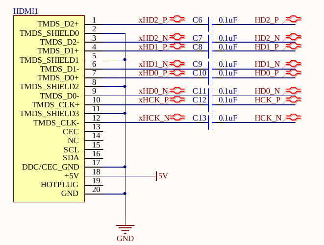

# HDMI na Ext-Board da Colorlight i9: análise elétrica

Status: **análise documental + simulação. Nenhuma medição.** Compatibilidade física com monitor real: **PENDING**.

## Fontes consultadas

| Ref. | Documento | O que fornece |
|---|---|---|
| S1 | `wuxx/Colorlight-FPGA-Projects` `schematic/i5-i9-extboard.pdf` (Altium, 29/10/2020, 2 folhas; commit 5042201) | Conector HDMI1, capacitores em série, nota HDx/HCK → esferas |
| S2 | mesmo repositório, `colorlight_i9_v7.x.md` | i9 v7.1 = v7.2 em GPIO; diferenças i5 → i9 (pino 41 do SODIMM: U16 → L2) |
| S3 | `litex-hub/litex-boards` `platforms/colorlight_i5.py` | Plataforma i5 7.0 / i9 7.2: `gpdi` em J19/G19/E20/C20, `LVCMOS33D`, `DRIVE=4` |
| S4 | `YosysHQ/prjtrellis-db` `ECP5/LFE5U-45F/iodb.json` | Banco, par diferencial (A/B) e função de cada esfera BG381 |

Hashes das cópias usadas: `docs/ecp5_evidence/SOURCES_SHA256.txt`. Recortes da folha 1 do S1 (Apache-2.0):
`docs/ecp5_evidence/extboard_hdmi1_connector_crop.png` e `extboard_hdmi_ball_note_crop.png`.

## O que o esquema mostra (S1, folha 1)

1. **Pares TMDS:** `xHDn_P/N` (lado do conector) passam por **C6..C13 = 0,1 µF em série**, viram `HDn_P/N` e
   seguem para o conector SODIMM do módulo. O acoplamento é **AC**.
2. **Sem resistores de terminação, polarização ou proteção ESD** desenhados no caminho TMDS. Também não há
   buffer/redriver (o HDMI sai direto das esferas do ECP5, através dos capacitores).
3. **CEC (13), SCL (15), SDA (16) e HOTPLUG (19) não têm ligação** no esquema. **NC (14)** é NC.
4. **+5V (18) ligado à rede 5V da placa** (alimentação DDC que a fonte fornece ao monitor). DDC/CEC_GND (17) e as
   blindagens (2, 5, 8, 11) vão a GND.
5. Nota na folha (recorte `extboard_hdmi_ball_note_crop.png`): HCK_N PR23B K19, HCK_P PR23A J19, HD0_N PR20B H20,
   HD0_P PR20A G19, HD1_N PR17B F19, HD1_P PR17A E20, HD2_N PR14B D19, HD2_P PR14A C20.

## Consequências para o projeto

| Item | Conclusão |
|---|---|
| Pinagem | Coincide com a referência da especificação P1 e com o S3. `HDMI_PINOUT.md` e `board/colorlight_i9_v72_extboard.lpf`. |
| Pares | S4: as oito esferas formam **4 pares verdadeiros A/B** (PR14, PR17, PR20, PR23) do **banco 2**, P = A, N = B. Polaridade P/N conforme o esquema (o LPF declara só o P; o N complementar é implícito em `LVCMOS33D`). |
| IO_TYPE | `LVCMOS33D` = dois drivers LVCMOS33 complementares (pseudo-diferencial), `DRIVE=4` como no S3. O ECP5 só oferece saída LVDS verdadeira com VCCIO = 2,5 V; com o banco a 3,3 V (inferido, ver abaixo), `LVCMOS33D` é a opção. Não é TMDS conforme a norma (corrente de 10 mA para 3,3 V terminado no receptor): funciona na prática com capacitores de acoplamento, como nos projetos de referência, mas **não há garantia de compatibilidade com todos os monitores**. |
| Taxa | 250 Mbit/s por lane (640×480 a 25 MHz), dentro da faixa usual de `ODDRX1F` + `LVCMOS33D` no grau -6 (P&R: domínio de 125 MHz com folga ≥ 80%, `TIMING_REPORT.md`). |
| VCCIO do banco 2 | **Não verificado em esquema**: o esquema do módulo i9 não é público. S3 e S2 usam LVCMOS33 em todos os pinos de usuário e o nextpnr aceitou `LVCMOS33D` no banco 2. **Medir VCCIO2 na placa** (`HARDWARE_TEST_GUIDE.md`). Se for 2,5 V, trocar para `LVDS` (sem mudança de RTL). |
| DDC / HPD / CEC | Fisicamente desligados: **nenhum pino FPGA atribuído**, nenhum sinal de 5 V chega ao ECP5. Não há leitura de EDID nem detecção de hot-plug. O transmissor não precisa: envia sempre 640×480 (VIC 1) e InfoFrames fixos. Monitores que exigem EDID/HPD do lado da fonte não são o problema (é o monitor que pede EDID à fonte); o efeito é que a fonte não se adapta ao monitor. |
| +5 V | Fornecido pela Ext-Board ao monitor; consumo DDC do monitor limitado pela fonte da placa. Sem relação com o FPGA. |
| Conflitos | As 8 esferas não aparecem em SDRAM, flash, PHYs Ethernet, JTAG, LED nem nos PMODs (S2, S3; checado por `scripts/ecp5_audit.py`). Os 4 pinos N ficam livres no LPF. |
| Proteção | Sem ESD no HDMI: evitar hot-plug do cabo com a placa ligada durante os primeiros testes. |

## Revisões e variantes verificadas

| Placa | Situação | Compatível com este bitstream/LPF? |
|---|---|---|
| Colorlight i9 **v7.2** (LFE5U-45F-6BG381C) | alvo | **Sim** |
| Colorlight i9 **v7.1** | S2: "GPIO layout of v7.1 is identical to v7.2" | Sim, pela documentação (não verificado em placa) |
| Colorlight **i5** v7.0 (LFE5U-25F) | mesma Ext-Board, LED em U16 | **Não**: outro dispositivo (25F) e menos EBR; exigiria nova síntese |
| Colorlight **i9plus v6.1** | **Xilinx XC7A50T**-FGG484, clock em K4, Ext-Board própria (`i9plus-extboard.pdf`, HDMI em esferas AA/AB) | **Não**: outra família FPGA |
| Ext-Board i5/i9 (esquema S1, "I5_V6.0/V7.0") | usada aqui | Sim |
| Outras revisões da Ext-Board (ex.: "v1.2" citada no S3) | o S3 informa as mesmas esferas para o HDMI e os PMODs | Provável, **não verificado**: conferir o rótulo da placa recebida |

Observação: o `src/amaranth_boards/colorlight_i9_r7_2.py` do próprio repositório wuxx lista `D16` como DQ27 da SDRAM.
A página S2 e o S3 dizem `D15`, e `D16` é um pino de PMOD (P5). O LPF usa D15 e não usa D16 para nada
(`SDRAM_32BIT_REPORT.md`).

## O que a síntese não pode garantir

- Integridade de sinal (impedância de 100 Ω diferencial, comprimento dos pares, conector SODIMM no caminho).
- Nível e amplitude reais do `LVCMOS33D` após os capacitores, com a terminação do monitor.
- Comportamento do monitor com sinal sem EDID/HPD e com áudio (alguns monitores DVI ignoram data islands, outros
  rejeitam 640×480 a 59,52 Hz).

Esses itens ficam **PENDING** até o teste com placa e monitor (`HARDWARE_TEST_GUIDE.md`).
